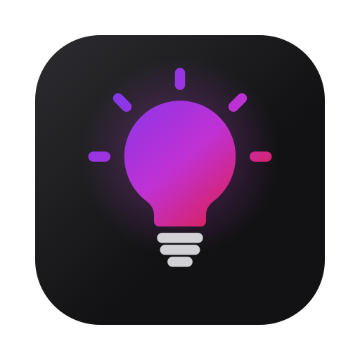

<p align="center">
  
</p>

<h1 align="center">Hue Menubar</h1>

<p align="center">
  A simple, elegant macOS menubar app for setting Philips Hue scenes.
</p>

## Features

- Activate any Hue scene from the menubar, grouped by room
- Keyboard shortcuts: <kbd>⌘1</kbd>–<kbd>⌘9</kbd> for scenes, <kbd>⌘0</kbd> for all lights off
- Scenes editor to order and select which scenes appear in the menu
- Guided bridge setup with automatic discovery and pairing
- Launch at login
- Talks to the bridge directly over the local network, with no cloud account needed

## Requirements

- macOS 14 or later
- A Philips Hue Bridge on the same network

## Install

1. Download `HueMenubar.zip` from the [latest release](https://github.com/oli-harris/hue-menubar/releases/latest) and unzip it.
2. Move `huemenubar.app` to `/Applications`.
3. Right-click the app and choose **Open**.

> [!NOTE]
> Release builds are unsigned, so macOS may block opening.

## Setup

On first launch, settings open on the **Bridge** tab. Follow the guided flow: the app finds your bridge, then asks you to press the button on top of it to pair. Once paired, your rooms and scenes appear in the menubar menu.

## Command line

The app includes a `hue` command. Link it into a folder on your `PATH`:

```bash
ln -sf /Applications/huemenubar.app/Contents/Resources/hue /opt/homebrew/bin/hue
```

or add the app's Resources folder to your `PATH` instead:

```bash
export PATH="/Applications/huemenubar.app/Contents/Resources:$PATH"
```

Settings > General has a button that copies the link command with the right path. The app must be paired first.

```
hue status [--json]                          bridge connection and lights on
hue rooms [--json]                           rooms, state, active scene, scenes
hue lights [--json]                          every light, including ones in no room
hue alias <light|room> <name> | --clear      local nickname
hue colours                                  CSS colour names and white keywords
hue colour <light|room|all> <value> [%]      #rrggbb, #rgb, CSS name, 2700K or warm/cool/...
hue on <light|room|all> [%]                  turn on, optionally at a brightness
hue off <light|room|all>
hue brightness <light|room|all> <0-100>
hue temp <light|room|all> <kelvin|candle|warm|neutral|cool|daylight>
hue scene <light|room> <scene>               a light only takes its own part of the scene
hue help
```

Targets match by id or name, case-insensitive; quote names with spaces. Use `room:` or `light:` when a name is both, and `all` for every light. Mistyped names are never auto-corrected, only suggested. Exit codes: 0 ok, 1 failed, 2 not paired, 64 usage error.

## Raycast

A [Raycast](https://raycast.com) extension in `raycast/` wraps the command line tool with commands for Control Lights, Set Scene, Set Colour, Set Brightness and Turn on Room / Turn off Room. It needs Node and the Hue Menubar app, which it finds at `/Applications/huemenubar.app` (change it in the extension's preferences).

```bash
cd raycast && npm install && npm run dev
```

Once built, the extension stays installed in Raycast after you stop `npm run dev`.

Light and room icons are from [hass-hue-icons](https://github.com/arallsopp/hass-hue-icons) by arallsopp, licensed [CC BY-NC-SA 4.0](https://creativecommons.org/licenses/by-nc-sa/4.0/). Changes: extracted individual icons, recoloured at runtime.

## Build from source

Requires Xcode with the macOS 14 SDK.

```bash
git clone https://github.com/oli-harris/hue-menubar.git
cd hue-menubar
xcodebuild -project huemenubar.xcodeproj -scheme huemenubar -configuration Release build
```
